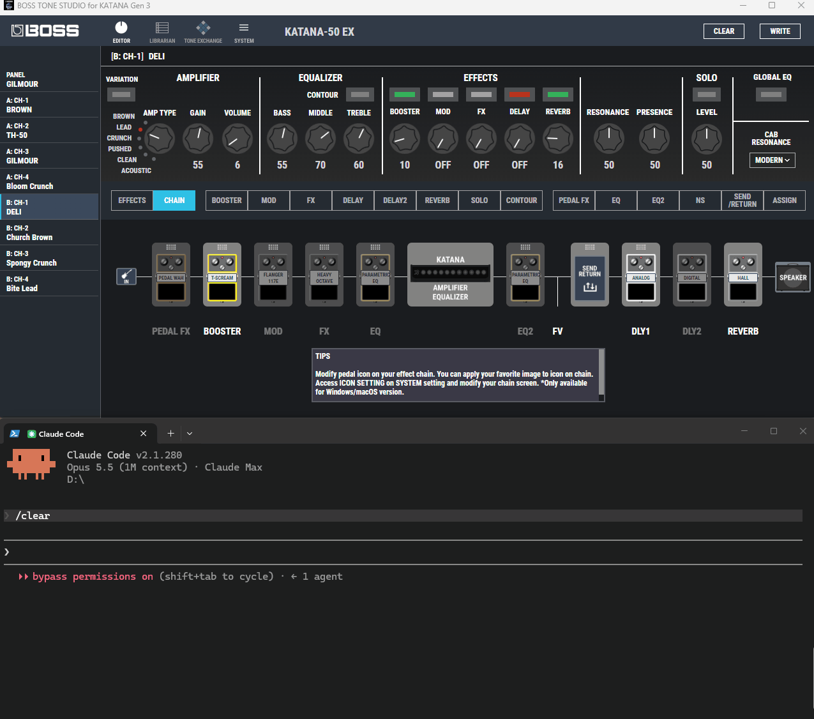
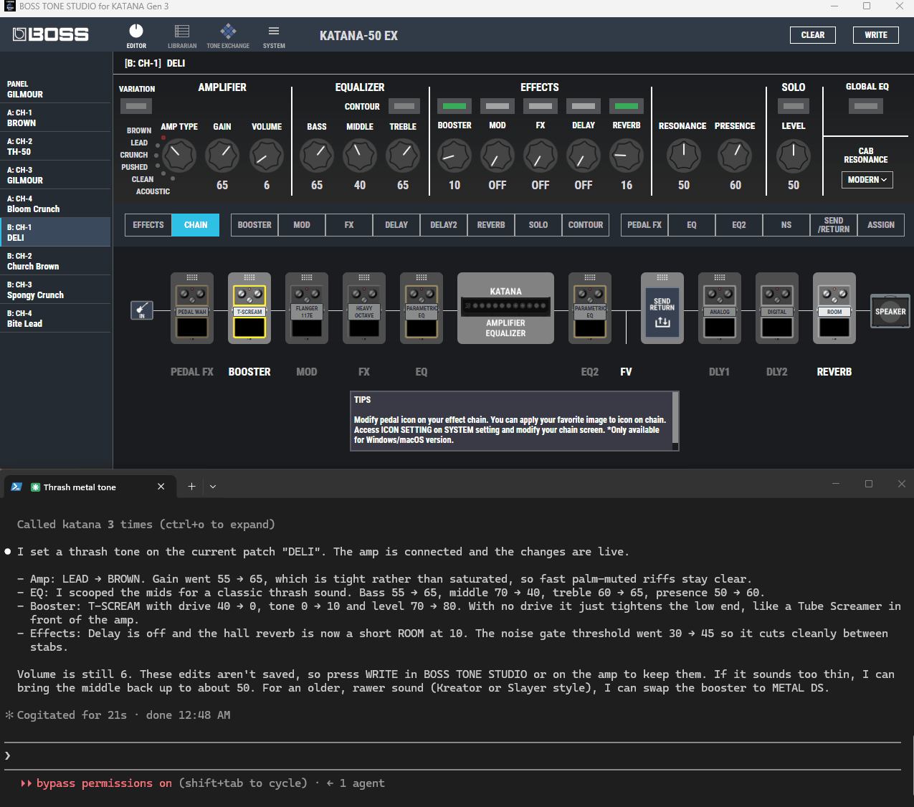

# boss-katana-mcp

Control a **BOSS KATANA Gen 3** amp in plain language from an AI coding agent: [Claude Code](https://claude.com/claude-code),
[Codex CLI](https://github.com/openai/codex) or [Gemini CLI](https://github.com/google-gemini/gemini-cli).

## Demo

Recorded in Claude Code; Codex CLI and Gemini CLI use the same MCP server and skill.

### "write a thrash metal tone"



One sentence in Claude Code, and the knobs in BOSS TONE STUDIO move on their own. Claude switches the amp from
LEAD to BROWN, scoops the mids, puts a T-SCREAM booster with zero drive in front of the amp to tighten the low end,
turns the delay off, swaps the hall reverb for a short ROOM and raises the noise gate threshold. It then explains
each change with its old and new value and reminds you to press WRITE if you want to keep it.

### "write blues tones with long sustain and delay"



A second request on the same patch, starting from the thrash tone. Claude moves the amp to CRUNCH, brings the
mids back, swaps the booster for a BLUES DRIVE, adds a compressor on the MOD slot for sustain, turns on an ANALOG
delay and changes the reverb to SPRING. Every change shows up live in the app while Claude is still working.

## Overview

Describe a tone — *"80s hard rock lead"*, *"a bit brighter"*, *"add some delay"*, *"volume to 12"* — and the agent
sets the amp and effect parameters through the original **BOSS TONE STUDIO for KATANA Gen 3** app. The app's
knobs and switches move live, exactly as if you had turned them yourself.

The project has two parts:

- **MCP server** (`katana`, Node/TypeScript) — the tools the agent calls to read and write parameters. It is a
  plain stdio MCP server, so any MCP client can use it.
- **Agent skill** (`katana-tone`) — tells the agent how to turn a tone description into parameter changes
  (workflow, safe ranges, amp/effect type names, starting points for common styles). It is a standard `SKILL.md`
  skill, which Claude Code, Codex CLI and Gemini CLI all load.

## Who is it for?

- **The player who thinks in sounds, not settings.** Knows the tone they want (*"Hendrix clean"*, *"thick
  doom riff"*) but not which gain, EQ or amp type gets there. The agent translates the description into parameter
  changes and explains what it changed, so they also learn the amp along the way.
- **The player who knows exactly what they want.** Would rather type *"gain 60, treble +2, delay 350 ms"* than
  click through BOSS TONE STUDIO's panels. Gets precise, multi-parameter edits in one sentence and can read the
  current tone back at any time.
- **The player with a guitar in their hands.** Practising or recording and doesn't want to reach for the mouse.
  Gives short, relative instructions (*"a bit brighter"*, *"delay off"*, *"less gain"*); the agent reads the current
  values first and adjusts from there. Edits stay live until WRITE is pressed, so experimenting can't overwrite a
  saved patch by accident.

> Not affiliated with or endorsed by Roland / BOSS. "BOSS", "KATANA" and "BOSS TONE STUDIO" are trademarks of
> Roland Corporation. No Roland files are included in this repository.

## Requirements

- Windows 10/11
- BOSS TONE STUDIO for KATANA Gen 3 (tested with 1.1.0), installed in its default location
- A KATANA Gen 3 amp connected over USB (other KATANA generations use a different BOSS TONE STUDIO app and are
  not supported)
- Node.js 24 or newer
- One of: Claude Code, Codex CLI or Gemini CLI

## Installation

### 1. Build

```powershell
git clone <repo-url> boss-katana-mcp
cd boss-katana-mcp
npm install
npm run build
```

(Windows PowerShell 5.1 has no `&&`; run the commands one by one or join them with `;`.)

### 2. Open BOSS TONE STUDIO's debug port

```powershell
powershell -ExecutionPolicy Bypass -File scripts\Enable-BossKatanaMcp.ps1
```

This sets a per-app WebView2 policy (current user only, no admin needed) so BOSS TONE STUDIO opens a DevTools
debug port on `127.0.0.1:9222` when it starts. Restart BOSS TONE STUDIO if it is already running.
Read [Security](#security) before enabling it. Undo with `scripts\Disable-BossKatanaMcp.ps1`.

### 3. Register the MCP server

Register it under the name `katana` with the CLI you use. The skill refers to the tools by these names.

**Claude Code** — run from the folder where you start Claude Code (local scope), or add `-s user` to make it
available everywhere:

```powershell
claude mcp add katana -- node C:/path/to/boss-katana-mcp/dist/index.js
```

**Codex CLI** — adds it to `%USERPROFILE%\.codex\config.toml`:

```powershell
codex mcp add katana -- node C:/path/to/boss-katana-mcp/dist/index.js
```

Codex asks before each MCP tool call. To let the `katana` tools run without asking, add this to the
`[mcp_servers.katana]` table in `config.toml`:

```toml
default_tools_approval_mode = "approve"
```

**Gemini CLI** — project scope by default, add `-s user` to make it available everywhere:

```powershell
gemini mcp add katana node C:/path/to/boss-katana-mcp/dist/index.js
```

Check it with `claude mcp list`, `codex mcp list` or `gemini mcp list`.

### 4. Install the skill

Put `skill/katana-tone` where your CLI looks for skills:

| CLI | For your user | For one project |
| --- | --- | --- |
| Claude Code | `%USERPROFILE%\.claude\skills\katana-tone` | `<project>\.claude\skills\katana-tone` |
| Codex CLI | `%USERPROFILE%\.agents\skills\katana-tone` | `<project>\.agents\skills\katana-tone` |
| Gemini CLI | `%USERPROFILE%\.agents\skills\katana-tone` | `<project>\.agents\skills\katana-tone` |

Codex CLI and Gemini CLI share `.agents\skills`, so one link covers both. A directory junction keeps the skill in
sync with the repo and needs no admin rights:

```powershell
# Claude Code
New-Item -ItemType Junction -Path "$env:USERPROFILE\.claude\skills\katana-tone" -Target "C:\path\to\boss-katana-mcp\skill\katana-tone"
# Codex CLI and Gemini CLI
New-Item -ItemType Junction -Path "$env:USERPROFILE\.agents\skills\katana-tone" -Target "C:\path\to\boss-katana-mcp\skill\katana-tone"
```

Create the parent `skills` folder first if it doesn't exist. Copying the folder works too. Restart the CLI so it
picks up the skill.

## Usage

1. Switch on the amp and connect it over USB.
2. Start your CLI and ask for a tone. You don't need to open BOSS TONE STUDIO first — the agent starts it and
   connects it to the amp when needed.

Examples:

```text
> give me an 80s hard rock lead tone
> a bit less gain, more middle
> add a short slapback delay
> turn the chorus off and set the reverb to spring
> volume 12
```

The agent replies with what changed (old → new) and why. Requests in other languages work as well.

**Changes are not saved automatically.** They are live edits of the current patch (the amp's edit buffer).
Press **WRITE** in BOSS TONE STUDIO or on the amp to store them in a patch.

### MCP tools

| Tool | What it does |
| --- | --- |
| `katana_status` | Is BOSS TONE STUDIO reachable, is the amp connected, current patch name, active variation (green/red/yellow) of each effect |
| `katana_launch` | Starts BOSS TONE STUDIO with the debug port, connects it to the amp and waits for the patch to load |
| `katana_connect` | Reconnects an already open BOSS TONE STUDIO to the amp (e.g. after the amp was power-cycled) |
| `katana_get` | Reads the current tone as friendly keys (`amp.gain`, `booster.type`, `delay.time`, …) |
| `katana_set` | Sets one or more parameters at once; the app UI updates immediately |
| `katana_list_params` | Lists one section's keys with their ranges and option names |

Sections: `amp`, `booster`, `mod`, `fx`, `delay`, `delay2`, `reverb`, `ns`, `eq`, `eq2`, `solo`, `pedalfx`,
`other`. Effects always edit the variation the panel currently shows.

## How it works

```
        Claude Code / Codex CLI / Gemini CLI
                          │ stdio
                          ▼
                 katana MCP server (Node)
                          │ Chrome DevTools Protocol, 127.0.0.1:9222
                          ▼
                     BOSS TONE STUDIO (WebView2 page)
                          │ USB MIDI
                          ▼
                       KATANA Gen 3
```

BOSS TONE STUDIO is a WebView2 app whose UI is an HTML/JS bundle. The MCP server attaches to that page over the
DevTools Protocol and uses the app's own code: `Parameter.setValue` writes a value and sends the Roland SysEx DT1
message to the amp, and the same DT1 is replayed into the app's MIDI-in handler so the knobs redraw. The app
remains the only program talking to the amp over MIDI. Each write briefly shows the app's own loading popup so
remote edits are easy to notice.

BOSS TONE STUDIO forgets the amp whenever the MIDI link drops and then asks *"Choose a device to connect with"* on
every start. `katana_launch` and `katana_connect` answer that dialog the way its OK button does (only when exactly
one KATANA MIDI device is listed) and wait until the amp's patch has loaded.

More detail: [docs/design.md](docs/design.md).

## Security

`Enable-BossKatanaMcp.ps1` makes BOSS TONE STUDIO **always** open its DevTools port on `127.0.0.1:9222`, not only
while this MCP server is in use. While the app is open, any local process can connect to that port and control
the app the same way this server does. The port is localhost-only, but 9222 is a common default and may clash
with other debugging tools. Run `scripts\Disable-BossKatanaMcp.ps1` (then restart BOSS TONE STUDIO) when you don't
need it.

## Troubleshooting

| Symptom | Fix |
| --- | --- |
| `BOSS TONE STUDIO is not reachable` | Run `Enable-BossKatanaMcp.ps1`, then restart BOSS TONE STUDIO (or let `katana_launch` start it) |
| `ampConnected: false` | Check the amp is on and the USB cable is connected, then ask the agent to reconnect (`katana_connect`) |
| Values look like defaults (`amp.volume 50`, patch `KATANA`) | The amp's patch hasn't loaded yet; wait for `ampConnected: true` |
| `katana_launch` can't find the app | BOSS TONE STUDIO must be installed in `C:\Program Files (x86)\BOSS\BOSS TONE STUDIO for KATANA Gen 3\` |
| `running without the debug port` | BOSS TONE STUDIO was started before the policy was set; close it and let the agent start it again |
| Port 9222 already in use | Close the other tool that uses 9222 (e.g. a browser started with remote debugging) |

## Development

```powershell
npm run build      # compile src/ to dist/
npm test           # unit tests
npm run test:e2e   # end-to-end tests against a running BOSS TONE STUDIO with the amp connected
```

The unit tests load BOSS TONE STUDIO's installed scripts from
`%LOCALAPPDATA%\Roland\BOSS TONE STUDIO for KATANA Gen 3\html\` into a sandbox, so the app must be installed
(and started once, so the bundle is extracted) on the machine running the tests.

```
src/
  index.ts        MCP stdio server entry
  tools.ts        MCP tool definitions and handlers
  catalog.ts      friendly key ⇄ BOSS TONE STUDIO parameter mapping, type names, variations
  page-agent.ts   script injected into the BOSS TONE STUDIO page (read, write, UI sync)
  cdp.ts          minimal DevTools Protocol client
  bts.ts          BOSS TONE STUDIO client over CDP
  connect.ts      connects the amp and waits for its patch to load
  launcher.ts     starts BOSS TONE STUDIO with the debug port
skill/katana-tone/SKILL.md   agent skill (Claude Code, Codex CLI, Gemini CLI)
scripts/                      enable/disable the WebView2 debug-port policy
test/                         unit and e2e tests
```

## License

[MIT](LICENSE) © 2026 Doğa Koçak

This is a hobby project, made for fun and without any commercial intent. It is not affiliated with Roland / BOSS.
